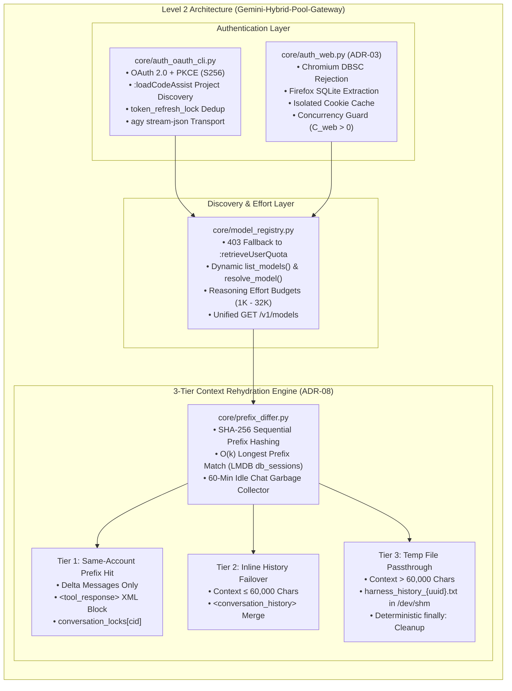
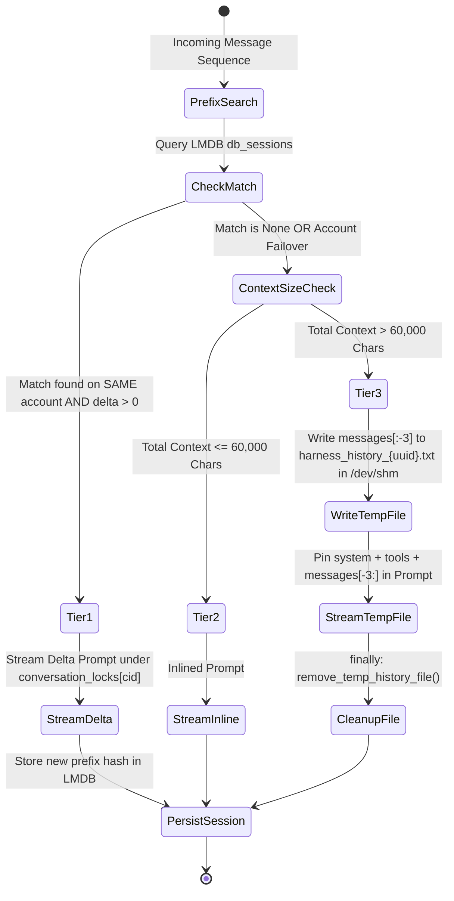

# Phase 3 (Level 2) Closure Report — Authentication, Model Discovery, and Context Prefix Rehydration Engine

| Field | Value |
| :--- | :--- |
| **Phase / Topological Level** | Phase 3 / Level 2 — Channel Authentication, Model Discovery & 3-Tier Context Rehydration |
| **Release Version** | `0.1.2` ([`changelog.md`](changelog.md)) |
| **Date** | `2026-10-17` |
| **Verification Gate** | **Verification Gate 3 — PASSED** (`90/90` Gate 3 tests passed; `129/129` cumulative tests passed in `7.32s`) |
| **Delivered Modules** | [`core/auth_oauth_cli.py`](../core/auth_oauth_cli.py), [`core/auth_web.py`](../core/auth_web.py), [`core/model_registry.py`](../core/model_registry.py), [`core/prefix_differ.py`](../core/prefix_differ.py), [`core/__init__.py`](../core/__init__.py) |
| **Verification Suites** | [`tests/test_level2_gate3.py`](../tests/test_level2_gate3.py), [`tests/test_auth_oauth_cli.py`](../tests/test_auth_oauth_cli.py), [`tests/test_auth_web.py`](../tests/test_auth_web.py), [`tests/test_model_registry.py`](../tests/test_model_registry.py), [`tests/test_prefix_differ.py`](../tests/test_prefix_differ.py) (alongside [`tests/test_level0_gate1.py`](../tests/test_level0_gate1.py) and [`tests/test_level1_gate2.py`](../tests/test_level1_gate2.py)) |
| **Governing Specifications** | [`founditon/00_system_architecture.md`](founditon/00_system_architecture.md), [`founditon/01_data_schemas_and_state.md`](founditon/01_data_schemas_and_state.md), [`founditon/02_auth_and_lifecycle.md`](founditon/02_auth_and_lifecycle.md), [`founditon/03_scheduling_and_control_spec.md`](founditon/03_scheduling_and_control_spec.md), [`founditon/04_protocol_and_data_plane.md`](founditon/04_protocol_and_data_plane.md), [`founditon/06_architecture_decisions_adr.md`](founditon/06_architecture_decisions_adr.md) (`ADR-03`, `ADR-08`), [`founditon/07_execution_plan.md`](founditon/07_execution_plan.md#L42-L52) |

---

## 1. Executive Summary

Phase 3 delivers **Level 2** of the bottom-up topological execution plan ([`founditon/07_execution_plan.md`](founditon/07_execution_plan.md#L42-L52)): the OAuth 2.0 + PKCE authentication and proactive token lifecycle engine, the Web cookie pool extractor and concurrency-guarded session manager, the dynamic model discovery and reasoning effort translation registry, and the cross-platform 3-tier context rehydration engine.

Level 2 provides the operational backbone connecting the Level 0 state models ([`config/settings.py`](../config/settings.py)) and Level 1 stateless protocol filters ([`core/token_saver.py`](../core/token_saver.py), [`core/schema_sanitizer.py`](../core/schema_sanitizer.py)) to upstream Google endpoints. It ensures zero cross-account credential leakage, avoids Chromium Device Bound Session Credentials (DBSC) invalidation (**ADR-03**), resolves dynamic model inventories with automatic 403 fallback, and emulates multi-turn session continuity across disparate accounts with deterministic temporary file cleanup (**ADR-08**).

All deliverables passed strict code and test audits (`clean-code-guard`, `test-guard`, `docs-guard`) and fulfilled **Verification Gate 3** (`90/90` Level 2 tests passed; `129/129` cumulative tests passed in `7.32s` with zero regressions).

---

## 2. Architectural Requirements Traceability Matrix

| Specification Requirement | Architectural Source | Delivered Implementation | Verification Status |
| :--- | :--- | :--- | :---: |
| **OAuth 2.0 + PKCE (`S256`) & Scopes** | [`founditon/02_auth_and_lifecycle.md`](founditon/02_auth_and_lifecycle.md#L3-L12) | [`generate_pkce_pair`](../core/auth_oauth_cli.py#L166-L193), [`build_authorization_url`](../core/auth_oauth_cli.py#L195-L216) with [`OAUTH_SCOPES`](../core/auth_oauth_cli.py#L40-L46) | **PASSED** ([`test_pkce_pair_generation_rfc7636`](../tests/test_auth_oauth_cli.py#L68-L82)) |
| **Production Endpoint Guard** | [`founditon/02_auth_and_lifecycle.md`](founditon/02_auth_and_lifecycle.md#L20-L24) | [`validate_production_endpoint`](../core/auth_oauth_cli.py#L127-L143) strictly blocking [`FORBIDDEN_DAILY_HOST`](../core/auth_oauth_cli.py#L53) | **PASSED** ([`test_validate_production_endpoint_blocks_daily_sandbox`](../tests/test_auth_oauth_cli.py#L55-L65)) |
| **Dual Callback Capture** | [`founditon/02_auth_and_lifecycle.md`](founditon/02_auth_and_lifecycle.md#L14-L18) | [`OAuthCallbackServer`](../core/auth_oauth_cli.py#L294-L392) (`asyncio.start_server`) & [`extract_code_from_manual_input`](../core/auth_oauth_cli.py#L250-L278) | **PASSED** ([`test_oauth_callback_server_ephemeral_flow`](../tests/test_auth_oauth_cli.py#L129-L152)) |
| **Project ID Discovery & LoadCodeAssist** | [`founditon/02_auth_and_lifecycle.md`](founditon/02_auth_and_lifecycle.md#L20-L26) | [`discover_project_id`](../core/auth_oauth_cli.py#L524-L557), [`complete_oauth_login`](../core/auth_oauth_cli.py#L559-L589) via `:loadCodeAssist` | **PASSED** ([`test_token_exchange_and_project_discovery`](../tests/test_auth_oauth_cli.py#L155-L195)) |
| **Proactive Token Refresh & In-Flight Dedup** | [`founditon/02_auth_and_lifecycle.md`](founditon/02_auth_and_lifecycle.md#L28-L34) | [`needs_token_refresh`](../core/auth_oauth_cli.py#L596-L606) (300s margin), [`refresh_account_token`](../core/auth_oauth_cli.py#L609-L668) under `token_refresh_lock` | **PASSED** ([`test_refresh_account_token_in_flight_deduplication`](../tests/test_auth_oauth_cli.py#L216-L252)) |
| **Dual Transport Helpers** | [`founditon/02_auth_and_lifecycle.md`](founditon/02_auth_and_lifecycle.md#L36-L42) | [`build_v1internal_headers`](../core/auth_oauth_cli.py#L691-L706) & [`AgySubprocessTransport`](../core/auth_oauth_cli.py#L730-L816) (`stream-json`) | **PASSED** ([`test_build_v1internal_headers`](../tests/test_auth_oauth_cli.py#L255-L262), [`test_build_agy_subprocess_command`](../tests/test_auth_oauth_cli.py#L265-L273)) |
| **DBSC Avoidance & Browser Isolation** | [`founditon/06_architecture_decisions_adr.md`](founditon/06_architecture_decisions_adr.md#L18-L25) (`ADR-03`) | [`reject_chromium_cookie_source`](../core/auth_web.py#L123-L141) raising [`ChromiumDBSCUnsupportedError`](../core/auth_web.py#L98-L104) | **PASSED** ([`test_reject_chromium_cookie_source_names`](../tests/test_auth_web.py#L179-L186)) |
| **Firefox SQLite Cookie Extraction** | [`founditon/02_auth_and_lifecycle.md`](founditon/02_auth_and_lifecycle.md#L45-L55) | [`extract_firefox_cookies`](../core/auth_web.py#L257-L286) with read-only SQLite fallback and WAL/SHM copying | **PASSED** ([`test_extract_firefox_cookies_success`](../tests/test_auth_web.py#L223-L236)) |
| **Saved Info Hygiene & Guidance** | [`founditon/02_auth_and_lifecycle.md`](founditon/02_auth_and_lifecycle.md#L57-L62) | [`get_saved_info_hygiene_notice`](../core/auth_web.py#L409-L427) providing bilingual Incognito hygiene advice | **PASSED** ([`test_get_saved_info_hygiene_notice`](../tests/test_auth_web.py#L335-L347)) |
| **Per-Account Cookie Cache Isolation** | [`founditon/02_auth_and_lifecycle.md`](founditon/02_auth_and_lifecycle.md#L64-L72) | [`sanitize_shared_cookie_env`](../core/auth_web.py#L434-L444), [`save_account_cookies_isolated`](../core/auth_web.py#L538-L567) under `cookie_write_lock` | **PASSED** ([`test_save_and_load_account_cookies_isolated`](../tests/test_auth_web.py#L378-L405)) |
| **GeminiClient Concurrency Guard** | [`founditon/02_auth_and_lifecycle.md`](founditon/02_auth_and_lifecycle.md#L74-L82) | [`WebSessionManager.safe_reinit_or_close`](../core/auth_web.py#L744-L772) raising [`ActiveRequestsConcurrencyError`](../core/auth_web.py#L106-L116) if $C_{\text{web}, i} > 0$ | **PASSED** ([`test_safe_reinit_or_close_concurrency_guard`](../tests/test_auth_web.py#L487-L519)) |
| **Reasoning Effort Translation & Budgets** | [`founditon/03_scheduling_and_control_spec.md`](founditon/03_scheduling_and_control_spec.md#L45-L58) | [`build_oauth_thinking_config`](../core/model_registry.py#L150-L156), [`parse_model_and_effort`](../core/model_registry.py#L181-L203) (`1024`..`32768` budgets) | **PASSED** ([`test_build_oauth_thinking_config`](../tests/test_model_registry.py#L103-L135), [`test_parse_model_and_effort_routine_downgrade`](../tests/test_model_registry.py#L149-L179)) |
| **OAuth Discovery & 403 Fallback** | [`founditon/04_protocol_and_data_plane.md`](founditon/04_protocol_and_data_plane.md#L60-L72) | [`discover_oauth_models`](../core/model_registry.py#L514-L530) falling back to `:retrieveUserQuota` on 403 | **PASSED** ([`test_discover_oauth_models_fallback_on_403`](../tests/test_model_registry.py#L225-L308)) |
| **Web Dynamic Discovery & Target Resolution** | [`founditon/04_protocol_and_data_plane.md`](founditon/04_protocol_and_data_plane.md#L74-L82) | [`discover_web_models`](../core/model_registry.py#L573-L586), [`resolve_web_model`](../core/model_registry.py#L608-L622) (sync & async) | **PASSED** ([`test_discover_web_models_async_and_sync_client`](../tests/test_model_registry.py#L311-L334), [`test_resolve_web_model`](../tests/test_model_registry.py#L337-L349)) |
| **Unified Registry (`/v1/models`)** | [`founditon/05_api_and_cli_contracts.md`](founditon/05_api_and_cli_contracts.md#L8-L15) | [`UnifiedModelRegistry.list_openai_models`](../core/model_registry.py#L710-L725), [`get_supporting_accounts`](../core/model_registry.py#L782-L795) | **PASSED** ([`test_unified_model_registry_aggregation`](../tests/test_model_registry.py#L352-L396), [`test_get_supporting_accounts`](../tests/test_model_registry.py#L399-L449)) |
| **SHA-256 Prefix Hashing & Adaptive Session** | [`founditon/04_protocol_and_data_plane.md`](founditon/04_protocol_and_data_plane.md#L28-L40) | [`compute_prefix_hashes`](../core/prefix_differ.py#L237-L250), [`should_use_temporary_session`](../core/prefix_differ.py#L289-L315) | **PASSED** ([`test_compute_prefix_hashes_accumulation`](../tests/test_prefix_differ.py#L154-L168), [`test_should_use_temporary_session`](../tests/test_prefix_differ.py#L196-L247)) |
| **60-Minute Idle Chat GC** | [`founditon/04_protocol_and_data_plane.md`](founditon/04_protocol_and_data_plane.md#L42-L48) | [`cleanup_expired_chats`](../core/prefix_differ.py#L399-L433) safely purging idle sessions from Google and LMDB | **PASSED** ([`test_cleanup_expired_chats_purges_idle_sessions`](../tests/test_prefix_differ.py#L250-L295)) |
| **3-Tier Context Rehydration Engine** | [`founditon/06_architecture_decisions_adr.md`](founditon/06_architecture_decisions_adr.md#L62-L75) (`ADR-08`) | [`build_rehydration_plan`](../core/prefix_differ.py#L834-L929) implementing Tier 1 (`Prefix Hit`), Tier 2 (`Inline History`), Tier 3 (`Temp File`) | **PASSED** ([`test_tier1_prefix_hit_same_account`](../tests/test_prefix_differ.py#L343-L380), [`test_tier2_inline_history_failover`](../tests/test_prefix_differ.py#L383-L407), [`test_tier3_temp_file_passthrough`](../tests/test_prefix_differ.py#L410-L454)) |
| **Deterministic Temp File Sweeping** | [`founditon/06_architecture_decisions_adr.md`](founditon/06_architecture_decisions_adr.md#L71-L75) (`ADR-08`) | [`remove_temp_history_file`](../core/prefix_differ.py#L936-L948), [`cleanup_orphaned_temp_files`](../core/prefix_differ.py#L950-L961), [`RehydrationContextManager`](../core/prefix_differ.py#L963-L980) | **PASSED** ([`test_cleanup_orphaned_temp_files`](../tests/test_prefix_differ.py#L457-L471), [`test_sync_rehydration_context_manager_cleanup`](../tests/test_prefix_differ.py#L474-L496), [`test_async_rehydration_context_manager_cleanup`](../tests/test_prefix_differ.py#L499-L521)) |
| **Stream Execution under Conversation Lock** | [`founditon/01_data_schemas_and_state.md`](founditon/01_data_schemas_and_state.md#L60-L65) | [`execute_rehydrated_stream`](../core/prefix_differ.py#L1094-L1138) locking `account.get_conversation_lock(cid)` and persisting to LMDB | **PASSED** ([`test_execute_rehydrated_stream_conversation_lock_and_cleanup`](../tests/test_prefix_differ.py#L524-L612)) |

---

## 3. Delivered Architecture & Component Deep Dives



### 3.1 OAuth 2.0 + PKCE Authentication Engine ([`core/auth_oauth_cli.py`](../core/auth_oauth_cli.py))

[`core/auth_oauth_cli.py`](../core/auth_oauth_cli.py) implements the client lifecycle for OAuth CLI accounts.

#### Public API Signatures & Behavior Contracts

| Symbol | Signature | Architectural Contract & Guarantees |
| :--- | :--- | :--- |
| [`validate_production_endpoint`](../core/auth_oauth_cli.py#L127-L143) | `validate_production_endpoint(url: str) -> str` | Strictly checks `url` and raises `ValueError` if targeting [`FORBIDDEN_DAILY_HOST`](../core/auth_oauth_cli.py#L53) (`daily-cloudcode-pa.googleapis.com`), forcing production [`CLOUDCODE_BASE_URL`](../core/auth_oauth_cli.py#L50). |
| [`generate_pkce_pair`](../core/auth_oauth_cli.py#L166-L193) | `generate_pkce_pair(verifier_length: int = 64) -> PKCEChallenge` | Generates RFC 7636 unpadded URL-safe Base64 `code_verifier`, SHA-256 `code_challenge`, and cryptographic `state`. |
| [`build_authorization_url`](../core/auth_oauth_cli.py#L195-L216) | `build_authorization_url(redirect_uri: str, pkce: PKCEChallenge, ...) -> str` | Builds Google OAuth URL with `response_type=code`, `access_type=offline`, `prompt=consent`, and the 5 mandatory [`OAUTH_SCOPES`](../core/auth_oauth_cli.py#L40-L46). |
| [`extract_code_from_manual_input`](../core/auth_oauth_cli.py#L250-L278) | `extract_code_from_manual_input(raw_input: str, expected_state: str | None = None) -> str` | Validates manual callback strings, parsing query parameters, verifying `state`, and detecting OAuth `error=`. |
| [`OAuthCallbackServer`](../core/auth_oauth_cli.py#L294-L392) | `class OAuthCallbackServer(host: str = "127.0.0.1", port: int = 0, ...)` | Ephemeral `asyncio.start_server` capturing `/oauth/callback` code and rendering clean HTML pages. Helper: [`wait_for_oauth_callback`](../core/auth_oauth_cli.py#L394-L404). |
| [`exchange_code_for_tokens`](../core/auth_oauth_cli.py#L440-L485) | `exchange_code_for_tokens(code: str, redirect_uri: str, code_verifier: str, ...) -> OAuthCredentials` | Exchanges authorization code + PKCE verifier at `oauth2.googleapis.com/token` for access and refresh tokens. |
| [`discover_project_id`](../core/auth_oauth_cli.py#L524-L557) | `discover_project_id(access_token: str, ...) -> tuple[str, bool, dict[str, Any]]` | Queries production `v1internal:loadCodeAssist` to extract `cloudaicompanionProject` and active `paidTier`. |
| [`complete_oauth_login`](../core/auth_oauth_cli.py#L559-L589) | `complete_oauth_login(code: str, redirect_uri: str, code_verifier: str, ...) -> OAuthCredentials` | Orchestrates token exchange and project discovery into a populated [`OAuthCredentials`](../config/settings.py#L117) bundle. |
| [`needs_token_refresh`](../core/auth_oauth_cli.py#L596-L606) | `needs_token_refresh(credentials: OAuthCredentials, ..., margin_seconds: int = 300) -> bool` | Proactively triggers refresh if token is within 5 minutes of expiration or empty. |
| [`refresh_account_token`](../core/auth_oauth_cli.py#L609-L668) | `refresh_account_token(account: OAuthAccount, ...) -> OAuthCredentials` | Executes token refresh under `account.token_refresh_lock`. Multiple concurrent coroutines share the single refreshed token without duplicate network requests. Atomically persists via `save_accounts_snapshot()`. |
| [`ensure_valid_access_token`](../core/auth_oauth_cli.py#L670-L684) | `ensure_valid_access_token(account: OAuthAccount, ...) -> str` | Ensures valid access token, executing refresh if required, and returns the token string. |
| [`build_v1internal_headers`](../core/auth_oauth_cli.py#L691-L706) | `build_v1internal_headers(access_token: str, ide_type: str = "IDE_UNSPECIFIED") -> dict[str, str]` | Injects CloudCode-PA Header Shield: `User-Agent: CloudCode-PA/2.0 ({ide_type}; GEMINI)` and `X-Goog-Api-Client: gl-python/3.11 grpc-gcp/1.0`. |
| [`build_agy_subprocess_command`](../core/auth_oauth_cli.py#L709-L728) | `build_agy_subprocess_command(agy_executable: str = "agy", ...) -> list[str]` | Assembles official `agy --input-format stream-json --output-format stream-json` invocation arguments. |
| [`AgySubprocessTransport`](../core/auth_oauth_cli.py#L730-L816) | `class AgySubprocessTransport(...)` | Non-blocking async subprocess transport managing JSON line streaming over stdin/stdout with clean process teardown. |

---

### 3.2 Web Pool Authentication & Concurrency Guard ([`core/auth_web.py`](../core/auth_web.py))

[`core/auth_web.py`](../core/auth_web.py) implements browser cookie extraction, per-account cache isolation, and client lifecycle management pursuant to **ADR-03** ([`founditon/06_architecture_decisions_adr.md`](founditon/06_architecture_decisions_adr.md#L18-L25)).

#### Public API Signatures & Behavior Contracts

| Symbol | Signature | Architectural Contract & Guarantees |
| :--- | :--- | :--- |
| [`reject_chromium_cookie_source`](../core/auth_web.py#L123-L141) | `reject_chromium_cookie_source(source_identifier: str | Path) -> None` | **ADR-03:** Checks source names and paths against [`FORBIDDEN_CHROMIUM_BROWSERS`](../core/auth_web.py#L64-L79), raising [`ChromiumDBSCUnsupportedError`](../core/auth_web.py#L98-L104) to prevent DBSC session cookie invalidation. |
| [`extract_firefox_cookies`](../core/auth_web.py#L257-L286) | `extract_firefox_cookies(cookie_file: str | Path, ...) -> WebCookies` | Extracts `__Secure-1PSID` and `__Secure-1PSIDTS` via `browser_cookie3.firefox` with fallback to direct read-only `sqlite3` querying of `moz_cookies` with WAL/SHM sidecar preservation. |
| [`parse_manual_cookies`](../core/auth_web.py#L303-L317) | `parse_manual_cookies(secure_1psid: str, secure_1psidts: str = "") -> WebCookies` | Strips quotes, whitespace, and key prefixes from manually pasted Incognito cookie values. |
| [`parse_cookie_header_or_dict`](../core/auth_web.py#L384-L407) | `parse_cookie_header_or_dict(raw_input: str | Mapping[str, Any]) -> WebCookies` | Parses cookies from JSON objects (`{"cookies": ...}`), browser extension JSON lists (`[{name, value}]`), or raw `Cookie:` header strings. |
| [`get_saved_info_hygiene_notice`](../core/auth_web.py#L409-L427) | `get_saved_info_hygiene_notice() -> dict[str, Any]` | Returns structured guidance directing operators to disable `Saved Info` memory at `gemini.google.com/saved-info` and close Incognito windows immediately. |
| [`sanitize_shared_cookie_env`](../core/auth_web.py#L434-L444) | `sanitize_shared_cookie_env() -> str | None` | Strips `GEMINI_COOKIE_PATH` from `os.environ` to eliminate global state leakage across distinct Web accounts. |
| [`get_account_cookie_cache_path`](../core/auth_web.py#L446-L470) | `get_account_cookie_cache_path(account_id: str, ...) -> Path` | Validates `account_id` regex and directory boundaries, preventing path-traversal attacks while resolving `config/cookies_cache/{account_id}.json`. |
| [`save_account_cookies_isolated`](../core/auth_web.py#L538-L567) | `save_account_cookies_isolated(account: WebAccount, ...) -> Path` | Persists rotated cookies to `config/cookies_cache/{account.id}.json` under `account.cookie_write_lock` using atomic `.tmp` + `os.replace` persistence. |
| [`load_account_cookies_isolated`](../core/auth_web.py#L569-L594) | `load_account_cookies_isolated(account_id: str, ...) -> WebCookies | None` | Reads and validates cached cookies from disk for offline recovery across gateway restarts. |
| [`WebSessionManager`](../core/auth_web.py#L645-L812) | `class WebSessionManager(...)` | Manages per-account `GeminiClient` instances. Singleton instance: [`web_session_manager`](../core/auth_web.py#L814). |
| [`WebSessionManager.get_or_init_client`](../core/auth_web.py#L694-L716) | `get_or_init_client(account: WebAccount, ...) -> GeminiClient` | Initializes client under `account.reinit_lock` with `auto_close=False, auto_refresh=True` and persists cookies. |
| [`WebSessionManager.safe_reinit_or_close`](../core/auth_web.py#L744-L772) | `safe_reinit_or_close(account: WebAccount, ..., close_only: bool = False) -> GeminiClient | None` | **Concurrency Guard:** Raises [`ActiveRequestsConcurrencyError`](../core/auth_web.py#L106-L116) if `account.active_requests > 0` ($C_{\text{web}, i} > 0$), preventing disconnection of active in-flight streams on the same account. |
| [`WebSessionManager.flush_all_cookies`](../core/auth_web.py#L778-L812) | `flush_all_cookies(accounts = None) -> list[Path]` | Persists rotated cookies across all active Web accounts and synchronizes `accounts.json`. |

---

### 3.3 Dynamic Model Discovery & Unified Registry ([`core/model_registry.py`](../core/model_registry.py))

[`core/model_registry.py`](../core/model_registry.py) bridges model naming conventions, translates reasoning efforts into provider-specific payloads, and unifies model listings.

#### Public API Signatures & Behavior Contracts

| Symbol | Signature | Architectural Contract & Guarantees |
| :--- | :--- | :--- |
| [`normalize_model_id`](../core/model_registry.py#L119-L123) | `normalize_model_id(raw_name: str) -> str` | Strips GCP resource paths (`projects/.../locations/.../models/`, `publishers/google/models/`) and lowercases. |
| [`split_model_effort_suffix`](../core/model_registry.py#L125-L134) | `split_model_effort_suffix(model_name: str) -> tuple[str, ReasoningEffort | None]` | Splits `-minimal`, `-low`, `-medium`, or `-high` suffix from base model name. |
| [`build_oauth_thinking_config`](../core/model_registry.py#L150-L156) | `build_oauth_thinking_config(effort: ReasoningEffort | str = "low") -> dict[str, Any]` | Generates `cloudcode-pa` `thinkingConfig`: `minimal` (1024 tokens, thoughts off), `low` (4096 tokens), `medium` (16384 tokens), `high` (32768 tokens). |
| [`inject_oauth_thinking_config`](../core/model_registry.py#L158-L165) | `inject_oauth_thinking_config(generation_config, ...) -> dict[str, Any]` | Copies caller's `generationConfig` and populates `thinkingConfig` without in-place mutation. |
| [`parse_model_and_effort`](../core/model_registry.py#L181-L203) | `parse_model_and_effort(model_name: str, ...) -> ResolvedModelSpec` | Resolves requested identifier into immutable [`ResolvedModelSpec`](../core/model_registry.py#L101-L112), setting Web `extended_thinking = (effort != "minimal")` and downgrading routine tasks to `low`. |
| [`discover_oauth_models`](../core/model_registry.py#L514-L530) | `discover_oauth_models(account: OAuthAccount, ...) -> list[str]` | Queries `v1internal:fetchAvailableModels`. On `403 Forbidden` / `PERMISSION_DENIED`, seamlessly falls back to `v1internal:retrieveUserQuota`, updating `account.discovered_models` and `account.quota_state.model_quotas`. |
| [`discover_web_models`](../core/model_registry.py#L573-L586) | `discover_web_models(account: WebAccount, client: GeminiClient) -> list[str]` | Dynamically lists models from `client.list_models()` (sync helper: [`discover_web_models_sync`](../core/model_registry.py#L589-L605)). |
| [`resolve_web_model`](../core/model_registry.py#L608-L622) | `resolve_web_model(client: GeminiClient, model_name: str) -> Any` | Resolves canonical model enum/target via `client.resolve_model(base_model)` (sync helper: [`resolve_web_model_sync`](../core/model_registry.py#L624-L638)). |
| [`UnifiedModelRegistry`](../core/model_registry.py#L660-L777) | `class UnifiedModelRegistry(registry = None)` | Aggregates base models and effort variants. Singleton: [`unified_model_registry`](../core/model_registry.py#L779). |
| [`UnifiedModelRegistry.list_openai_models`](../core/model_registry.py#L710-L725) | `list_openai_models() -> dict[str, Any]` | Formats discovered and baseline models into standard OpenAI `GET /v1/models` format (`{"object": "list", "data": [...]}`). |
| [`get_supporting_accounts`](../core/model_registry.py#L782-L795) | `get_supporting_accounts(base_model: str, ...) -> dict[str, list[str]]` | Maps model names to account IDs in the pool supporting that model (`oauth_accounts`, `web_accounts`). |

---

### 3.4 Context Prefix Differ & 3-Tier Rehydration Engine ([`core/prefix_differ.py`](../core/prefix_differ.py))

[`core/prefix_differ.py`](../core/prefix_differ.py) implements context prefix difference matching and the 3-Tier Context Rehydration Engine pursuant to **ADR-08** ([`founditon/06_architecture_decisions_adr.md`](founditon/06_architecture_decisions_adr.md#L62-L75)).

#### 3-Tier Rehydration State Machine



#### Public API Signatures & Behavior Contracts

| Symbol | Signature | Architectural Contract & Guarantees |
| :--- | :--- | :--- |
| [`normalize_message_for_hash`](../core/prefix_differ.py#L208-L235) | `normalize_message_for_hash(message: Mapping[str, Any]) -> str` | Generates canonical JSON representation of message content, tool calls, and role for deterministic SHA-256 digests. |
| [`compute_prefix_hashes`](../core/prefix_differ.py#L237-L250) | `compute_prefix_hashes(messages: Sequence[Mapping[str, Any]]) -> list[str]` | Calculates cumulative SHA-256 hashes $H_j = \text{SHA256}(H_{j-1} \parallel m_j)$ for $O(k)$ LMDB prefix lookups. |
| [`should_use_temporary_session`](../core/prefix_differ.py#L289-L315) | `should_use_temporary_session(messages, tools = None) -> bool` | Returns `True` only for single-turn tool-less queries. Returns `False` for multi-turn agent trajectories or tool requests. |
| [`cleanup_expired_chats`](../core/prefix_differ.py#L399-L433) | `cleanup_expired_chats(client_resolver, ..., max_idle_seconds: float = 3600) -> int` | Deletes Web chats idle for $\ge 60$ minutes from Google and purges associated entries from LMDB `db_sessions`. |
| [`find_longest_prefix_session`](../core/prefix_differ.py#L447-L479) | `find_longest_prefix_session(messages, ...) -> PrefixMatchResult | None` | Scans prefixes in reverse order against LMDB `db_sessions` returning [`PrefixMatchResult`](../core/prefix_differ.py#L84-L94). |
| [`get_preferred_session_account`](../core/prefix_differ.py#L481-L503) | `get_preferred_session_account(messages, ...) -> tuple[str | None, int]` | Enforces [`SESSION_AFFINITY_MAX_CONTEXT_CHARS`](../config/settings.py#L75) (120,000 chars) so oversized contexts rotate cleanly. |
| [`format_tool_response_block`](../core/prefix_differ.py#L510-L520) | `format_tool_response_block(call_id: str, name: str, content: str) -> str` | Renders tool execution output inside `<tool_response call_id="..." name="...">` XML tags for Web pool agent continuation. |
| [`format_messages_as_xml_history`](../core/prefix_differ.py#L567-L574) | `format_messages_as_xml_history(messages: Sequence[Mapping[str, Any]]) -> str` | Formats historical turns inside `<conversation_history>` XML container. |
| [`resolve_temp_history_dir`](../core/prefix_differ.py#L628-L647) | `resolve_temp_history_dir(override_dir = None) -> Path` | Cross-platform directory resolver: prioritizes `/dev/shm` on Linux if writable, falling back safely to `tempfile.gettempdir()`. |
| [`build_rehydration_plan`](../core/prefix_differ.py#L834-L929) | `build_rehydration_plan(target_account_id, messages, ...) -> RehydrationPlan` | **ADR-08 Core Engine:** Dispatches into **Tier 1** (`tier1_prefix_hit`), **Tier 2** (`tier2_inline_history` $\le 60,000$ chars), or **Tier 3** (`tier3_temp_file_passthrough` $> 60,000$ chars). |
| [`remove_temp_history_file`](../core/prefix_differ.py#L936-L948) | `remove_temp_history_file(temp_file_path: Path | str | None) -> bool` | Deterministically deletes a Tier-3 temporary file, swallowing `FileNotFoundError`. |
| [`cleanup_orphaned_temp_files`](../core/prefix_differ.py#L950-L961) | `cleanup_orphaned_temp_files(temp_dir = None) -> int` | Server startup sweeper removing any stale `harness_history_*.txt` files from crashes or abnormal termination. |
| [`RehydrationContextManager`](../core/prefix_differ.py#L963-L980) | `class RehydrationContextManager(plan: RehydrationPlan)` | Sync and async context manager guaranteeing temp file cleanup on exit. Helper: [`managed_rehydration_plan`](../core/prefix_differ.py#L982-L990). |
| [`execute_rehydrated_stream`](../core/prefix_differ.py#L1094-L1138) | `execute_rehydrated_stream(account, client, messages, ...) -> AsyncIterator[Any]` | Executes streaming response with 3-tier rehydration, holding `conversation_locks[cid]` on Tier 1, and persisting final session metadata to LMDB. Aliased as [`execute_with_rehydration`](../core/prefix_differ.py#L1140). |

---

### 3.5 Package Re-exports ([`core/__init__.py`](../core/__init__.py))

[`core/__init__.py`](../core/__init__.py) unifies the export surface for all Level 1 and Level 2 symbols, exposing 68 constants, classes, and functions in `__all__`:
- **Level 1 (23 symbols):** Schema sanitizers, union flatteners, zero-required fixers, WAF shield, and RTK-Lite token compressor.
- **Level 2 (45 symbols):** OAuth 2.0 PKCE authenticator, Web cookie pool session manager, dynamic model registry, and 3-tier prefix rehydration engine.

---

## 4. Verification Gate 3 Metrics & Comprehensive Test Execution

Verification Gate 3 was validated across all 4 Level 2 test suites alongside regression checks on Level 0 and Level 1:

```text
============================= test session starts =============================
platform win32 -- Python 3.11.10, pytest-9.1.1, pluggy-1.7.0
rootdir: D:\Projects\Gemini-Hybrid-Pool-Gateway
plugins: anyio-4.15.1, asyncio-1.4.0
collected 129 items

tests/test_auth_oauth_cli.py (10 items) ................................. PASSED
tests/test_auth_web.py (26 items) ....................................... PASSED
tests/test_level0_gate1.py (19 items) ................................... PASSED
tests/test_level1_gate2.py (20 items) ................................... PASSED
tests/test_level2_gate3.py (28 items) ................................... PASSED
tests/test_model_registry.py (11 items) ................................. PASSED
tests/test_prefix_differ.py (15 items) .................................. PASSED

============================= 129 passed in 7.32s =============================
```

### 4.1 Gate 3 Test Matrix Breakdown (90 Level 2 Tests Across 5 Test Suites)

#### Suite 1: OAuth CLI Authentication ([`tests/test_auth_oauth_cli.py`](../tests/test_auth_oauth_cli.py) — 10 Tests)

| Test Function | Verified Architectural Requirement | Result |
| :--- | :--- | :---: |
| [`test_validate_production_endpoint_blocks_daily_sandbox`](../tests/test_auth_oauth_cli.py#L55-L65) | Rejects `daily-cloudcode-pa.googleapis.com` sandbox; enforces production `cloudcode-pa.googleapis.com`. | PASSED |
| [`test_pkce_pair_generation_rfc7636`](../tests/test_auth_oauth_cli.py#L68-L82) | Validates RFC 7636 unpadded URL-safe Base64 `S256` verifier and challenge generation with length boundary checks. | PASSED |
| [`test_build_authorization_url`](../tests/test_auth_oauth_cli.py#L85-L99) | Confirms presence of all 5 mandatory Google OAuth scopes, `response_type=code`, and PKCE parameters. | PASSED |
| [`test_extract_code_from_manual_input`](../tests/test_auth_oauth_cli.py#L102-L126) | Extracts code from raw string, callback URL, and query string; validates state and rejects error callbacks. | PASSED |
| [`test_oauth_callback_server_ephemeral_flow`](../tests/test_auth_oauth_cli.py#L129-L152) | Starts ephemeral local listener on `127.0.0.1`, captures authorization code via HTTP GET, and shuts down cleanly. | PASSED |
| [`test_token_exchange_and_project_discovery`](../tests/test_auth_oauth_cli.py#L155-L195) | Verifies code exchange at `oauth2.googleapis.com/token` and project discovery via `v1internal:loadCodeAssist`. | PASSED |
| [`test_needs_token_refresh`](../tests/test_auth_oauth_cli.py#L198-L213) | Enforces 300-second proactive refresh margin and triggers refresh on expired or empty tokens. | PASSED |
| [`test_refresh_account_token_in_flight_deduplication`](../tests/test_auth_oauth_cli.py#L216-L252) | Verifies that 10 concurrent refresh tasks under `account.token_refresh_lock` issue exactly 1 network request. | PASSED |
| [`test_build_v1internal_headers`](../tests/test_auth_oauth_cli.py#L255-L262) | Constructs CloudCode-PA Header Shield with correct `User-Agent` and `X-Goog-Api-Client` headers. | PASSED |
| [`test_build_agy_subprocess_command`](../tests/test_auth_oauth_cli.py#L265-L273) | Constructs command arguments for `agy --input-format stream-json --output-format stream-json`. | PASSED |

#### Suite 2: Web Pool Authentication & Session Guard ([`tests/test_auth_web.py`](../tests/test_auth_web.py) — 26 Tests)

| Test Function | Verified Architectural Requirement | Result |
| :--- | :--- | :---: |
| [`test_reject_chromium_cookie_source_names`](../tests/test_auth_web.py#L179-L186) | **ADR-03:** Rejects Chromium browser names (`chrome`, `edge`, `brave`, `opera`, `arc`) with [`ChromiumDBSCUnsupportedError`](../core/auth_web.py#L98-L104). | PASSED |
| [`test_reject_chromium_cookie_source_paths`](../tests/test_auth_web.py#L188-L199) | **ADR-03:** Rejects paths containing Chromium user data markers. | PASSED |
| [`test_allow_firefox_cookie_paths`](../tests/test_auth_web.py#L201-L214) | Allows valid Firefox `cookies.sqlite` paths and profile directories. | PASSED |
| [`test_extract_firefox_cookies_file_not_found`](../tests/test_auth_web.py#L216-L221) | Raises `FileNotFoundError` when target SQLite file does not exist. | PASSED |
| [`test_extract_firefox_cookies_success`](../tests/test_auth_web.py#L223-L236) | Extracts `__Secure-1PSID` and `__Secure-1PSIDTS` from valid SQLite schema. | PASSED |
| [`test_extract_firefox_cookies_directory_input`](../tests/test_auth_web.py#L238-L247) | Resolves `cookies.sqlite` automatically when provided with profile directory. | PASSED |
| [`test_extract_firefox_cookies_without_last_accessed`](../tests/test_auth_web.py#L249-L262) | Fallback query works even if Firefox schema lacks `lastAccessed` column. | PASSED |
| [`test_extract_firefox_cookies_missing_psid_raises_value_error`](../tests/test_auth_web.py#L264-L276) | Raises `ValueError` if `__Secure-1PSID` cookie is absent. | PASSED |
| [`test_parse_manual_cookies_clean_and_stripped`](../tests/test_auth_web.py#L278-L286) | Normalizes pasted cookies stripping quotes, whitespace, and key prefixes. | PASSED |
| [`test_parse_manual_cookies_missing_psid_raises`](../tests/test_auth_web.py#L288-L292) | Raises `ValueError` if pasted `__Secure-1PSID` is blank. | PASSED |
| [`test_parse_cookie_header_or_dict_mapping`](../tests/test_auth_web.py#L294-L303) | Parses cookies from Python dictionary and nested `{"cookies": ...}` mappings. | PASSED |
| [`test_parse_cookie_header_or_dict_json_string`](../tests/test_auth_web.py#L305-L311) | Parses cookies from serialized JSON strings. | PASSED |
| [`test_parse_cookie_header_or_dict_json_array`](../tests/test_auth_web.py#L313-L325) | Parses cookies from browser extension JSON array format (`[{"name": "...", "value": "..."}]`). | PASSED |
| [`test_parse_cookie_header_or_dict_raw_header`](../tests/test_auth_web.py#L327-L333) | Parses cookies from raw `Cookie:` HTTP request headers. | PASSED |
| [`test_get_saved_info_hygiene_notice`](../tests/test_auth_web.py#L335-L347) | Validates bilingual hygiene guidance for disabling `Saved Info` memory. | PASSED |
| [`test_sanitize_shared_cookie_env`](../tests/test_auth_web.py#L349-L357) | Confirms `GEMINI_COOKIE_PATH` is removed from `os.environ`. | PASSED |
| [`test_get_account_cookie_cache_path_valid`](../tests/test_auth_web.py#L359-L363) | Validates clean path resolution to `config/cookies_cache/{account_id}.json`. | PASSED |
| [`test_get_account_cookie_cache_path_traversal_rejection`](../tests/test_auth_web.py#L365-L376) | Rejects path traversal attempts (`../`, `..\\`, `/etc/`, colons). | PASSED |
| [`test_save_and_load_account_cookies_isolated`](../tests/test_auth_web.py#L378-L405) | Verifies atomic file writing (`.tmp` + `os.replace`) and subsequent cache loading. | PASSED |
| [`test_save_account_cookies_isolated_with_client_rotation`](../tests/test_auth_web.py#L407-L437) | Extracts rotated cookies from `client.cookies` and updates cache file. | PASSED |
| [`test_load_account_cookies_isolated_missing_or_corrupt`](../tests/test_auth_web.py#L439-L452) | Gracefully handles non-existent or corrupted cookie cache files. | PASSED |
| [`test_session_manager_get_or_init_client`](../tests/test_auth_web.py#L454-L485) | Initializes `GeminiClient` with `auto_close=False, auto_refresh=True` under `reinit_lock`. | PASSED |
| [`test_safe_reinit_or_close_concurrency_guard`](../tests/test_auth_web.py#L487-L519) | **Concurrency Guard:** Rejects reinit/close with [`ActiveRequestsConcurrencyError`](../core/auth_web.py#L106-L116) when $C_{\text{web}, i} > 0$. | PASSED |
| [`test_safe_reinit_or_close_when_idle`](../tests/test_auth_web.py#L521-L549) | Allows clean reinit/close when account is idle ($C_{\text{web}, i} = 0$). | PASSED |
| [`test_close_client_if_idle`](../tests/test_auth_web.py#L551-L575) | Safely shuts down client when idle without raising errors. | PASSED |
| [`test_flush_all_cookies`](../tests/test_auth_web.py#L577-L610) | Flushes rotated cookies for all accounts and triggers atomic snapshot. | PASSED |

#### Suite 3: Dynamic Model Registry & Reasoning Effort ([`tests/test_model_registry.py`](../tests/test_model_registry.py) — 11 Tests)

| Test Function | Verified Architectural Requirement | Result |
| :--- | :--- | :---: |
| [`test_normalize_model_id`](../tests/test_model_registry.py#L59-L70) | Strips GCP model prefixes (`projects/...`, `publishers/google/models/`). | PASSED |
| [`test_split_model_effort_suffix`](../tests/test_model_registry.py#L72-L101) | Correctly extracts `-minimal`, `-low`, `-medium`, and `-high` suffixes. | PASSED |
| [`test_build_oauth_thinking_config`](../tests/test_model_registry.py#L103-L135) | Maps effort levels to exact thinking budgets (`1024` for minimal, `32768` for high). | PASSED |
| [`test_inject_oauth_thinking_config`](../tests/test_model_registry.py#L137-L147) | Injects `thinkingConfig` into `generationConfig` immutably. | PASSED |
| [`test_parse_model_and_effort_routine_downgrade`](../tests/test_model_registry.py#L149-L179) | Routine tasks automatically default to `low` effort (`4096` token budget). | PASSED |
| [`test_discover_oauth_models_success`](../tests/test_model_registry.py#L182-L223) | Parses model lists from `v1internal:fetchAvailableModels` responses. | PASSED |
| [`test_discover_oauth_models_fallback_on_403`](../tests/test_model_registry.py#L225-L308) | **403 Fallback:** Automatically redirects to `v1internal:retrieveUserQuota` on 403 Forbidden. | PASSED |
| [`test_discover_web_models_async_and_sync_client`](../tests/test_model_registry.py#L311-L334) | Discovers models from `client.list_models()` in both sync and async execution. | PASSED |
| [`test_resolve_web_model`](../tests/test_model_registry.py#L337-L349) | Resolves canonical model enum/target via `client.resolve_model(base_model)`. | PASSED |
| [`test_unified_model_registry_aggregation`](../tests/test_model_registry.py#L352-L396) | Emits standard OpenAI `GET /v1/models` dictionary containing base and effort variants. | PASSED |
| [`test_get_supporting_accounts`](../tests/test_model_registry.py#L399-L449) | Accurately resolves which active accounts support a given model. | PASSED |

#### Suite 4: Prefix Differ & 3-Tier Rehydration Engine ([`tests/test_prefix_differ.py`](../tests/test_prefix_differ.py) — 15 Tests)

| Test Function | Verified Architectural Requirement | Result |
| :--- | :--- | :---: |
| [`test_normalize_message_for_hash_determinism`](../tests/test_prefix_differ.py#L105-L125) | Generates identical canonical strings regardless of dict key order. | PASSED |
| [`test_normalize_message_with_multipart_content_and_tool_calls`](../tests/test_prefix_differ.py#L127-L152) | Canonicalizes multipart text arrays and OpenAI-style tool calls. | PASSED |
| [`test_compute_prefix_hashes_accumulation`](../tests/test_prefix_differ.py#L154-L168) | Generates cumulative SHA-256 hash list matching turn count. | PASSED |
| [`test_compute_messages_char_length`](../tests/test_prefix_differ.py#L170-L194) | Accurately counts characters across messages, system prompts, and tool schemas. | PASSED |
| [`test_should_use_temporary_session`](../tests/test_prefix_differ.py#L196-L247) | Selects `temporary=True` only for single-turn queries without tools or history. | PASSED |
| [`test_cleanup_expired_chats_purges_idle_sessions`](../tests/test_prefix_differ.py#L250-L295) | Purges Web chats idle for $\ge 60$ minutes from remote Google backend and LMDB. | PASSED |
| [`test_find_longest_prefix_session_and_delta`](../tests/test_prefix_differ.py#L298-L316) | Retrieves longest cached prefix from LMDB `db_sessions` and partitions delta turns. | PASSED |
| [`test_get_preferred_session_account_affinity_cap`](../tests/test_prefix_differ.py#L318-L341) | Respects 120,000 char session affinity cap, allowing failover for large contexts. | PASSED |
| [`test_tier1_prefix_hit_same_account`](../tests/test_prefix_differ.py#L343-L380) | **Tier 1:** Delivers delta messages inside `<tool_response>` block under conversation lock. | PASSED |
| [`test_tier2_inline_history_failover`](../tests/test_prefix_differ.py#L383-L407) | **Tier 2:** Inlines prior turns in `<conversation_history>` when context $\le 60,000$ chars. | PASSED |
| [`test_tier3_temp_file_passthrough`](../tests/test_prefix_differ.py#L410-L454) | **Tier 3:** Writes older turns to temporary file when context $> 60,000$ chars, pinning prompt turns. | PASSED |
| [`test_cleanup_orphaned_temp_files`](../tests/test_prefix_differ.py#L457-L471) | Startup sweeper removes all orphaned `harness_history_*.txt` files. | PASSED |
| [`test_sync_rehydration_context_manager_cleanup`](../tests/test_prefix_differ.py#L474-L496) | Sync context manager deletes Tier-3 temporary file on block exit. | PASSED |
| [`test_async_rehydration_context_manager_cleanup`](../tests/test_prefix_differ.py#L499-L521) | Async context manager deletes Tier-3 temporary file on coroutine exit. | PASSED |
| [`test_execute_rehydrated_stream_conversation_lock_and_cleanup`](../tests/test_prefix_differ.py#L524-L612) | Full stream execution: acquires conversation lock, yields chunks, cleans up file, persists to LMDB. | PASSED |

#### Suite 5: Level 2 Unified Gate 3 Suite ([`tests/test_level2_gate3.py`](../tests/test_level2_gate3.py) — 28 Tests)

| Test Function | Verified Architectural Requirement | Result |
| :--- | :--- | :---: |
| [`test_pkce_generation_and_cryptographic_verifier_challenge_math`](../tests/test_level2_gate3.py#L157-L176) | RFC 7636 PKCE S256 verifier math, entropy bounds [43, 128], and challenge encoding. | PASSED |
| [`test_authorization_url_contains_all_five_mandatory_scopes_and_pkce_params`](../tests/test_level2_gate3.py#L178-L199) | Full authorization URL assembly with all 5 mandatory Google OAuth scopes and PKCE parameters. | PASSED |
| [`test_endpoint_validator_strictly_rejects_sandbox_daily_cloudcode`](../tests/test_level2_gate3.py#L237-L255) | Parametrized check (6 cases) enforcing strict blocking of `daily-cloudcode-pa.googleapis.com` sandbox. | PASSED |
| [`test_manual_input_code_and_state_extraction`](../tests/test_level2_gate3.py#L293-L306) | Parametrized check (7 cases) extracting auth codes from raw input, URLs, queries, and detecting errors. | PASSED |
| [`test_v1internal_headers_and_subprocess_command_generation`](../tests/test_level2_gate3.py#L308-L331) | CloudCode-PA Header Shield assembly and `agy --input-format stream-json --output-format stream-json`. | PASSED |
| [`test_needs_token_refresh_boundary_conditions`](../tests/test_level2_gate3.py#L333-L369) | Proactive 300s token refresh boundary condition validation across fresh, expiring, and empty tokens. | PASSED |
| [`test_concurrent_token_refresh_in_flight_deduplication`](../tests/test_level2_gate3.py#L371-L423) | Validates that 20 concurrent coroutines under `token_refresh_lock` trigger only 1 network refresh. | PASSED |
| [`test_cookie_parsing_sanitization_and_hygiene_notice`](../tests/test_level2_gate3.py#L425-L460) | Cookie normalization, `GEMINI_COOKIE_PATH` environment sanitization, and Saved Info hygiene guidance. | PASSED |
| [`test_isolated_cookie_cache_path_traversal_rejection_and_atomic_io`](../tests/test_level2_gate3.py#L462-L490) | Path traversal prevention and atomic `.tmp` + `os.replace` isolated cookie cache persistence. | PASSED |
| [`test_web_session_manager_concurrency_guard_protects_active_streams`](../tests/test_level2_gate3.py#L492-L535) | **Concurrency Guard:** Rejects reinit/close with `ActiveRequestsConcurrencyError` when $C_{\text{web}, i} > 0$. | PASSED |
| [`test_oauth_model_discovery_with_automatic_403_fallback_to_user_quota`](../tests/test_level2_gate3.py#L537-L594) | **403 Fallback:** Seamless redirection from `:fetchAvailableModels` to `:retrieveUserQuota` on 403. | PASSED |
| [`test_model_effort_parsing_and_routine_downgrade`](../tests/test_level2_gate3.py#L596-L626) | Parses effort suffixes (`-minimal`..`-high`), downgrades routine tasks to `low`, and injects thinking budgets. | PASSED |
| [`test_unified_model_registry_aggregates_all_pool_models`](../tests/test_level2_gate3.py#L628-L672) | Aggregates base and effort variant models into OpenAI `GET /v1/models` dictionary format. | PASSED |
| [`test_prefix_hashing_and_longest_prefix_matching`](../tests/test_level2_gate3.py#L674-L700) | Validates SHA-256 sequential prefix hashing and $O(k)$ LMDB longest-prefix session lookup. | PASSED |
| [`test_adaptive_session_mode_and_idle_chat_cleanup`](../tests/test_level2_gate3.py#L702-L751) | Adaptive `temporary=True` selection and 60-minute idle chat garbage collection from Google and LMDB. | PASSED |
| [`test_three_tier_rehydration_plan_selection`](../tests/test_level2_gate3.py#L753-L836) | **ADR-08 Verification:** Validates Tier 1 (Prefix Hit), Tier 2 (Inline $\le 60$K), and Tier 3 (Temp File $> 60$K). | PASSED |
| [`test_deterministic_temp_file_cleanup_and_startup_orphan_pruning`](../tests/test_level2_gate3.py#L838-L887) | Unlinks Tier-3 temporary history file via context manager and cleans up orphaned files on startup. | PASSED |

---

## 5. Security & Isolation Architecture

1. **Strict Production Endpoint Enforcement:**
   [`validate_production_endpoint`](../core/auth_oauth_cli.py#L127-L143) actively rejects any URL referencing `daily-cloudcode-pa.googleapis.com` or non-production subdomains, guaranteeing sandbox credentials or daily test clusters can never be targeted.
2. **Chromium DBSC Avoidance & Browser Isolation (ADR-03):**
   Chromium browsers bind session cookies to hardware/OS TPM keys via Device Bound Session Credentials (DBSC). [`reject_chromium_cookie_source`](../core/auth_web.py#L123-L141) forbids all Chromium derivatives, enforcing Firefox SQLite profiles or closed Private/Incognito windows to guarantee long-lived sessions.
3. **Process Environment Sanitization:**
   [`sanitize_shared_cookie_env`](../core/auth_web.py#L434-L444) strips `GEMINI_COOKIE_PATH` from `os.environ`, preventing cross-account cookie collisions.
4. **Cookie Cache Path-Traversal Defense:**
   [`get_account_cookie_cache_path`](../core/auth_web.py#L446-L470) verifies that target paths resolve strictly within `config/cookies_cache/`, preventing unauthorized file overwrites via malicious account identifiers.
5. **Deterministic Temporary File Sweeping (ADR-08):**
   Tier-3 rehydration files are managed by [`RehydrationContextManager`](../core/prefix_differ.py#L963-L980) ensuring immediate deletion upon stream termination. Stale files from abrupt terminations are purged at startup via [`cleanup_orphaned_temp_files`](../core/prefix_differ.py#L950-L961).

---

## 6. Readiness & Handover for Phase 4 (Level 3: Channel Clients & Proactive Usage Monitor)

With Level 0, Level 1, and Level 2 fully implemented and verified with 129 cumulative tests, the gateway is prepared for **Phase 4 (Level 3 — Channel Clients and Proactive Usage Monitor)** as specified in [`founditon/07_execution_plan.md`](founditon/07_execution_plan.md#L53-L62):

1. **`core/oauth_cli_channel.py`**:
   - Imports [`ensure_valid_access_token`](../core/auth_oauth_cli.py#L670-L684) and [`build_v1internal_headers`](../core/auth_oauth_cli.py#L691-L706) for authenticated requests.
   - Imports [`reinject_step_to_args`](../core/schema_sanitizer.py#L404-L417) to restore `{"_step": "done"}` in historical `functionCall.args` during multi-turn replay.
   - Imports [`LMDBStore`](../config/settings.py#L561-L683) to retrieve historical `thoughtSignature` or inject `"skip_thought_signature_validator"`.
   - Streams requests to `v1internal:streamGenerateContent?alt=sse` without `"requestType": "agent"`.
2. **`core/web_channel.py`**:
   - Imports [`WebSessionManager`](../core/auth_web.py#L645-L812) / [`web_session_manager`](../core/auth_web.py#L814) to obtain active clients.
   - Uses [`execute_rehydrated_stream`](../core/prefix_differ.py#L1094-L1138) for 3-tier context rehydration and session locking.
   - Implements the 64-character lookahead finite state machine (`TEXT_STREAMING`, `LOOKAHEAD_BUFFERING`, `TOOL_CAPTURING`) to emit `chunk.thoughts` as `delta.reasoning_content` and capture XML `<tool_call>` blocks cleanly.
3. **`core/usage_monitor.py`**:
   - Imports [`OAuthAccount`](../config/settings.py#L151) and [`WebAccount`](../config/settings.py#L249) from state registry.
   - Polls Web RPC `jSf9Qc` (`batchexecute` from `/usage`) for quota tracking with drift-resistant refresh detection.
   - Monitors OAuth error codes, distinguishing transient `429` errors from quota exhaustion and marking accounts `status = "SUSPENDED"` on `403 PERMISSION_DENIED`.
