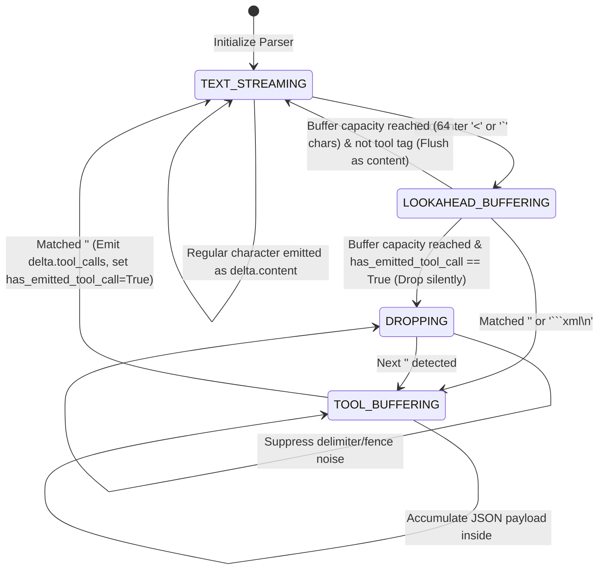

# Phase 4 (Level 3) Closure Report — Channel Clients & Proactive Quota Monitoring Engine

| Field | Value |
| :--- | :--- |
| **Phase / Topological Level** | Phase 4 / Level 3 — Dual-Channel Clients (`OAuth CLI` & `Web Cookie`) & Proactive Usage Monitor |
| **Release Version** | `0.1.3` ([`changelog.md`](changelog.md)) |
| **Date** | `2026-10-17` |
| **Verification Gate** | **Verification Gate 4 — PASSED** (`28/28` Gate 4 integration tests passed; `81/81` Level 3 tests passed; `210/210` cumulative repository tests passed in `7.54s`) |
| **Delivered Modules** | [`core/oauth_cli_channel.py`](../core/oauth_cli_channel.py), [`core/web_channel.py`](../core/web_channel.py), [`core/usage_monitor.py`](../core/usage_monitor.py), [`core/__init__.py`](../core/__init__.py) |
| **Verification Suites** | [`tests/test_level3_gate4.py`](../tests/test_level3_gate4.py), [`tests/test_oauth_cli_channel.py`](../tests/test_oauth_cli_channel.py), [`tests/test_web_channel.py`](../tests/test_web_channel.py), [`tests/test_usage_monitor.py`](../tests/test_usage_monitor.py) |
| **Cumulative Test Suites** | [`tests/test_level0_gate1.py`](../tests/test_level0_gate1.py), [`tests/test_level1_gate2.py`](../tests/test_level1_gate2.py), [`tests/test_level2_gate3.py`](../tests/test_level2_gate3.py), [`tests/test_auth_oauth_cli.py`](../tests/test_auth_oauth_cli.py), [`tests/test_auth_web.py`](../tests/test_auth_web.py), [`tests/test_model_registry.py`](../tests/test_model_registry.py), [`tests/test_prefix_differ.py`](../tests/test_prefix_differ.py) |
| **Governing Specifications** | [`founditon/00_system_architecture.md`](founditon/00_system_architecture.md), [`founditon/01_data_schemas_and_state.md`](founditon/01_data_schemas_and_state.md), [`founditon/02_auth_and_lifecycle.md`](founditon/02_auth_and_lifecycle.md), [`founditon/03_scheduling_and_control_spec.md`](founditon/03_scheduling_and_control_spec.md), [`founditon/04_protocol_and_data_plane.md`](founditon/04_protocol_and_data_plane.md), [`founditon/06_architecture_decisions_adr.md`](founditon/06_architecture_decisions_adr.md) (`ADR-04`, `ADR-05`, `ADR-06`, `ADR-09`), [`founditon/07_execution_plan.md`](founditon/07_execution_plan.md#L54-L64) |

---

## 1. Executive Summary

Phase 4 delivers **Level 3** of the bottom-up topological execution plan ([`founditon/07_execution_plan.md`](founditon/07_execution_plan.md#L54-L64)): the dual-channel client engines for upstream Google endpoints and the proactive quota monitoring system.

Level 3 operationalizes the authentication tokens and prefix rehydration sessions developed in Level 2 ([`core/auth_oauth_cli.py`](../core/auth_oauth_cli.py), [`core/auth_web.py`](../core/auth_web.py), [`core/prefix_differ.py`](../core/prefix_differ.py)), binding them to high-throughput data-plane streaming channels that expose standard OpenAI-compatible Server-Sent Events (SSE) interfaces:

1. **OAuth CLI Channel (`core/oauth_cli_channel.py`):** Directly interfaces with Google Cloud Code's `v1internal:streamGenerateContent?alt=sse` endpoint. It enforces strict omission of `"requestType": "agent"` (**ADR-04**), applies the official CloudCode Header Shield, re-injects `_step: "done"` into historical `functionCall.args` (**ADR-05**), manages cryptographic `thoughtSignature` persistence in LMDB `db_signatures` with automatic fallback to `skip_thought_signature_validator` (**ADR-06**), nests tool output images as `inlineData` in `functionResponse.parts`, applies the Post-Assembly Model-Turn Guard, and streams reasoning thoughts as `delta.reasoning_content`.
2. **Web Cookie Pool Channel (`core/web_channel.py`):** Bridges the browser-based Gemini Web endpoint with the OpenAI chat completion standard. It features the lookahead state-machine parser `MultiToolLookaheadParser` (**ADR-09**) that guarantees zero delimiter or markdown code block leakage after tool calls begin, extracts sequential tool invocations with unique identifiers, dispatches live thoughts immediately to avoid client TTFT timeouts, and computes context-weighted optimistic $\Delta_{5h}$ consumption upon stream completion.
3. **Proactive Usage Monitor (`core/usage_monitor.py`):** Acts as the sentinel for account health and quota preservation. It parses raw Google RPC `jSf9Qc` payloads from `batchexecute`, executes drift-safe reset zeroing on 5-hour and weekly windows, classifies HTTP 429 rejections using `quotaResetDelay` to distinguish genuine quota exhaustion from transient bursts, executes atomic disk state flushes via `save_accounts_snapshot()`, and manages account suspensions permanently.

All deliverables underwent rigorous integration testing via [`tests/test_level3_gate4.py`](../tests/test_level3_gate4.py). The cumulative repository test suite achieved a **100% pass rate** (`210/210` tests passed in `7.54s` with zero regressions), certifying the passage of **Verification Gate 4**.

---

## 2. Architectural Requirements Traceability Matrix

| Specification Requirement | Architectural Source | Delivered Implementation | Verification Status |
| :--- | :--- | :--- | :---: |
| **Strict Request Envelope Guard (ADR-04)** | [`founditon/06_architecture_decisions_adr.md`](founditon/06_architecture_decisions_adr.md#L28-L38) | [`build_v1internal_envelope`](../core/oauth_cli_channel.py#L481-L542) strictly forbidding `"requestType": "agent"` anywhere in envelope | **PASSED** ([`test_v1internal_envelope_strictly_prohibits_request_type_agent`](../tests/test_level3_gate4.py#L742-L768)) |
| **CloudCode Header Shield** | [`founditon/02_auth_and_lifecycle.md`](founditon/02_auth_and_lifecycle.md#L36-L42) | [`OAuthCLIChannel.stream_chat`](../core/oauth_cli_channel.py#L900-L958) injecting [`build_v1internal_headers`](../core/auth_oauth_cli.py#L691-L706) | **PASSED** ([`test_v1internal_headers_shield`](../tests/test_oauth_cli_channel.py#L112-L121)) |
| **WAF System Prompt Sanitization** | [`founditon/04_protocol_and_data_plane.md`](founditon/04_protocol_and_data_plane.md#L15-L25) | [`extract_and_sanitize_system_instruction`](../core/oauth_cli_channel.py#L150-L195) with [`sanitize_system_prompt_text`](../core/schema_sanitizer.py#L83-L100) | **PASSED** ([`test_extract_and_sanitize_system_instruction`](../tests/test_oauth_cli_channel.py#L178-L210)) |
| **Zero-Property Tool History Replay (ADR-05)** | [`founditon/06_architecture_decisions_adr.md`](founditon/06_architecture_decisions_adr.md#L40-L50) | [`convert_messages_to_v1internal_contents`](../core/oauth_cli_channel.py#L307-L473) re-injecting `_step: "done"` & stripping in [`transform_candidate_to_openai_chunks`](../core/oauth_cli_channel.py#L571-L690) | **PASSED** ([`test_oauth_history_replay_step_injection_and_chunk_stripping`](../tests/test_level3_gate4.py#L328-L383)) |
| **LMDB ThoughtSignature Caching (ADR-06)** | [`founditon/06_architecture_decisions_adr.md`](founditon/06_architecture_decisions_adr.md#L52-L60) | Persisting `thoughtSignature` to `LMDBStore.db_signatures` on emit; fetching or defaulting to `skip_thought_signature_validator` | **PASSED** ([`test_oauth_sse_stores_emitted_thought_signature_in_lmdb`](../tests/test_level3_gate4.py#L210-L257), [`test_oauth_convert_messages_retrieves_thought_signature_from_lmdb`](../tests/test_level3_gate4.py#L260-L300)) |
| **Tool Inline Image Nesting (ADR-06)** | [`founditon/06_architecture_decisions_adr.md`](founditon/06_architecture_decisions_adr.md#L57-L60) | Nesting base64 tool images inside `functionResponse.parts` as `inlineData` | **PASSED** ([`test_oauth_inline_images_nested_in_function_response_parts`](../tests/test_level3_gate4.py#L386-L417)) |
| **Post-Assembly Model-Turn Guard** | [`founditon/04_protocol_and_data_plane.md`](founditon/04_protocol_and_data_plane.md#L20-L24) | Appending `{"role": "user", "parts": [{"text": "Continue."}]}` if `contents[-1]` is `model` | **PASSED** ([`test_oauth_post_assembly_model_turn_guard_appends_continue`](../tests/test_level3_gate4.py#L420-L433)) |
| **Multi-Tool Lookahead State Machine (ADR-09)** | [`founditon/06_architecture_decisions_adr.md`](founditon/06_architecture_decisions_adr.md#L78-L90) | [`MultiToolLookaheadParser`](../core/web_channel.py#L305-L536) suppressing post-tool text and parsing sequential `<tool_call>` tags | **PASSED** ([`test_multi_tool_parser_adr09_no_delimiter_text_leak_after_tool_starts`](../tests/test_level3_gate4.py#L782-L808), [`test_multi_tool_parser_sequential_multiple_tool_calls_indices_and_ids`](../tests/test_level3_gate4.py#L811-L843)) |
| **Split-Boundary Buffer Reassembly** | [`founditon/04_protocol_and_data_plane.md`](founditon/04_protocol_and_data_plane.md#L88-L96) | Lookahead buffer (`capacity=64`) assembling fragmented tokens across chunk edges | **PASSED** ([`test_multi_tool_parser_lookahead_split_boundary_reconstitution`](../tests/test_level3_gate4.py#L868-L897)) |
| **Web Channel Delta-5h Accounting** | [`founditon/03_scheduling_and_control_spec.md`](founditon/03_scheduling_and_control_spec.md#L30-L42) | [`compute_context_scaled_delta_5h`](../core/web_channel.py#L542-L557) & accumulation in [`execute_web_channel_stream`](../core/web_channel.py#L695-L715) | **PASSED** ([`test_web_channel_calculates_context_scaled_delta_5h_boundary_math`](../tests/test_level3_gate4.py#L438-L455), [`test_web_channel_stream_successful_completion_updates_usage_and_timestamps`](../tests/test_level3_gate4.py#L457-L506)) |
| **Web Concurrency Guard ($C_{\text{web}, i}$)** | [`founditon/02_auth_and_lifecycle.md`](founditon/02_auth_and_lifecycle.md#L74-L82) | Active request counter tracking and safe re-init rejection during streaming | **PASSED** ([`test_web_session_concurrency_guard_and_usage_monitor_recording`](../tests/test_level3_gate4.py#L509-L530)) |
| **QuotaResetDelay Parser & 429 Classifier** | [`founditon/03_scheduling_and_control_spec.md`](founditon/03_scheduling_and_control_spec.md#L15-L25) | [`parse_quota_reset_delay`](../core/usage_monitor.py#L166-L209) & [`classify_and_handle_oauth_429`](../core/usage_monitor.py#L265-L324) | **PASSED** ([`test_oauth_429_with_quota_reset_delay_transitions_account_to_cooldown`](../tests/test_level3_gate4.py#L560-L598), [`test_oauth_429_burst_limit_avoids_cooldown_and_preserves_active_status`](../tests/test_level3_gate4.py#L601-L623)) |
| **Atomic State Persistence under Lock** | [`founditon/01_data_schemas_and_state.md`](founditon/01_data_schemas_and_state.md#L45-L55) | Flushes `state_registry` snapshots via [`save_accounts_snapshot`](../config/settings.py#L556-L582) | **PASSED** ([`test_oauth_429_atomic_snapshot_persistence_integrity`](../tests/test_level3_gate4.py#L626-L654)) |
| **Drift-Safe Reset Detection (ADR-02)** | [`founditon/06_architecture_decisions_adr.md`](founditon/06_architecture_decisions_adr.md#L10-L16) | [`check_and_apply_drift_safe_resets`](../core/usage_monitor.py#L574-L619) checking `now >= reset_time` & clearing optimistic deltas | **PASSED** ([`test_drift_safe_reset_on_5h_window_expiry_zeroes_optimistic_delta`](../tests/test_level3_gate4.py#L682-L700), [`test_drift_safe_reset_on_live_rpc_jsf9qc_sync_clears_optimistic_delta`](../tests/test_level3_gate4.py#L703-L726)) |
| **Google RPC `jSf9Qc` XSSI Parsing** | [`founditon/04_protocol_and_data_plane.md`](founditon/04_protocol_and_data_plane.md#L98-L115) | [`strip_xssi_prefix`](../core/usage_monitor.py#L372-L382) & [`parse_jsf9qc_usage_response`](../core/usage_monitor.py#L385-L567) | **PASSED** ([`test_rpc_jsf9qc_payload_parsing_with_xssi_and_tier_mapping`](../tests/test_level3_gate4.py#L737-L762)) |
| **Central Dual-Pool Synchronization** | [`founditon/03_scheduling_and_control_spec.md`](founditon/03_scheduling_and_control_spec.md#L65-L75) | [`sync_all_registered_accounts`](../core/usage_monitor.py#L855-L943) driving concurrent OAuth & Web health passes | **PASSED** ([`test_usage_monitor_sync_all_orchestration_across_both_channels`](../tests/test_level3_gate4.py#L1015-L1039)) |

---

## 3. Delivered Architecture & Component Deep Dives

```mermaid
flowchart TD
    subgraph Level_3["Level 3 Architecture (Gemini-Hybrid-Pool-Gateway)"]
        direction TB

        subgraph Ingress["OpenAI Client Request Ingress"]
            REQ["POST /v1/chat/completions<br/>(Stream = True)"]
        end

        subgraph Channels["Dual-Channel Dispatch Layer"]
            OAUTH_CH["core/oauth_cli_channel.py<br/>• Strict Request Envelope (ADR-04)<br/>• CloudCode Header Shield<br/>• WAF System Instruction Shield<br/>• History Replay _step Injection (ADR-05)<br/>• Model-Turn Guard ('Continue.')<br/>• Dual Transport (HTTP/2 & agy)"]
            WEB_CH["core/web_channel.py<br/>• MultiToolLookaheadParser (ADR-09)<br/>• Zero Post-Tool Content Leakage<br/>• Immediate Thought Dispatch<br/>• Concurrency Guard Tracking<br/>• Context-Weighted Delta_5h"]
        end

        subgraph LMDB_Layer["Storage & Cache Plane"]
            SIG_DB["LMDB db_signatures<br/>• tool_call_id <-> thoughtSignature<br/>• skip_thought_signature_validator"]
            SESS_DB["LMDB db_sessions<br/>• Prefix Hash Cache"]
        end

        subgraph Monitor_Layer["Sentinel & Quota Plane"]
            MONITOR["core/usage_monitor.py<br/>• Google RPC jSf9Qc XSSI Extractor<br/>• Drift-Safe Reset Zeroing (now >= reset)<br/>• QuotaResetDelay 429 Analyzer<br/>• COOLDOWN Transitions<br/>• Permanent Suspension Handler<br/>• save_accounts_snapshot() under Lock"]
        end

        subgraph Upstream["Google Endpoints"]
            G_OAUTH["cloudcode-pa.googleapis.com<br/>/v1internal:streamGenerateContent"]
            G_WEB["gemini.google.com<br/>BardChatUi/data/batchexecute"]
        end

        REQ --> OAUTH_CH
        REQ --> WEB_CH
        OAUTH_CH <--> SIG_DB
        OAUTH_CH --> G_OAUTH
        WEB_CH --> SESS_DB
        WEB_CH --> G_WEB
        G_OAUTH -.->|429 RESOURCE_EXHAUSTED| MONITOR
        G_WEB -.->|RPC jSf9Qc /usage| MONITOR
        WEB_CH -->|Successful Stream Complete| MONITOR
        MONITOR -->|State Update & Atomic Flush| Level_3
    end
```

### 3.1 OAuth CLI Channel & Protocol Gateway ([`core/oauth_cli_channel.py`](../core/oauth_cli_channel.py))

[`core/oauth_cli_channel.py`](../core/oauth_cli_channel.py) implements the low-latency HTTP/2 and subprocess gateway connecting clients to Google's production `cloudcode-pa.googleapis.com` infrastructure.

#### Public API Signatures & Architectural Guarantees

| Symbol | Signature | Architectural Contract & Guarantees |
| :--- | :--- | :--- |
| [`build_v1internal_envelope`](../core/oauth_cli_channel.py#L481-L542) | `build_v1internal_envelope(contents, model, *, project_id=None, system_instruction=None, tools=None, generation_config=None, ...) -> dict[str, Any]` | Assembles the JSON payload for `v1internal`. Strictly bans `"requestType": "agent"` (**ADR-04**), injecting reasoning effort thinking configs and generating RFC-compliant metadata. |
| [`convert_messages_to_v1internal_contents`](../core/oauth_cli_channel.py#L307-L473) | `convert_messages_to_v1internal_contents(messages, *, lmdb_store=None, zero_property_tool_names=None) -> list[dict[str, Any]]` | Maps OpenAI roles to Gemini roles (`system`/`developer` -> `systemInstruction`, `assistant` -> `model`, `tool` -> `functionResponse`). Re-injects `_step: "done"` into historical functionCall arguments (**ADR-05**), fetches `thoughtSignature` from LMDB or defaults to `skip_thought_signature_validator` (**ADR-06**), nests tool output images as `inlineData` in `functionResponse.parts`, and applies the Post-Assembly Model-Turn Guard. |
| [`transform_candidate_to_openai_chunks`](../core/oauth_cli_channel.py#L571-L690) | `transform_candidate_to_openai_chunks(candidate, *, model, request_id, lmdb_store=None, tool_call_start_index=0) -> tuple[list[dict[str, Any]], int]` | De-multiplexes candidate parts into OpenAI chunks. Streams `thought: true` parts as `delta.reasoning_content`, text as `delta.content`, and `functionCall` as `delta.tool_calls` (stripping synthetic `_step` and automatically persisting emitted `thoughtSignature` to `LMDBStore.db_signatures`). |
| [`parse_v1internal_sse_line`](../core/oauth_cli_channel.py#L550-L569) | `parse_v1internal_sse_line(raw_line: str) -> dict[str, Any] | None` | Parses raw SSE data lines, ignoring heartbeats, comments, and `data: [DONE]`. |
| [`OAuthCLIChannel`](../core/oauth_cli_channel.py#L820-L959) | `class OAuthCLIChannel(lmdb_store=None, endpoint_url=V1INTERNAL_STREAM_URL, default_timeout=DEFAULT_TIMEOUT_SECONDS)` | Stateful high-level channel client executing HTTP/2 streaming completions via `httpx.AsyncClient` or subprocess streaming completions via `AgySubprocessTransport`. Exposes [`default_oauth_cli_channel`](../core/oauth_cli_channel.py#L962). |

---

### 3.2 Web Cookie Pool Channel & State-Machine Parser ([`core/web_channel.py`](../core/web_channel.py))

[`core/web_channel.py`](../core/web_channel.py) manages the conversion of upstream Web turns into OpenAI SSE format, featuring the token-level lookahead parser **ADR-09**.

#### MultiToolLookaheadParser State Machine Architecture



#### Public API Signatures & Architectural Guarantees

| Symbol | Signature | Architectural Contract & Guarantees |
| :--- | :--- | :--- |
| [`MultiToolLookaheadParser`](../core/web_channel.py#L305-L536) | `class MultiToolLookaheadParser(capacity: int = 64)` | Lookahead state-machine parser implementing **ADR-09**. Guarantees zero token leakage after tool calls begin, strips enclosing ````xml\n...```` fences, extracts sequential tools with unique IDs, and reconstitutes split-chunk boundaries. |
| [`compute_context_scaled_delta_5h`](../core/web_channel.py#L542-L557) | `compute_context_scaled_delta_5h(model_name: str, context_chars: int) -> float` | Computes context-weighted optimistic quota consumption: $\Delta_{5h}(m, L) = \Delta_{\text{base}}(m) \times (1.0 + 0.25 \times (L / 25000))$, capped at `100.0`. |
| [`execute_web_channel_stream`](../core/web_channel.py#L613-L715) | `execute_web_channel_stream(account, client, messages, model, ...) -> AsyncIterator[StreamChunk]` | Orchestrates rehydration execution, streams live reasoning thoughts immediately, parses tool invocations, and updates `account.optimistic_5h_delta` and `account.last_completed_timestamp` upon completion. |
| [`WebChannel`](../core/web_channel.py#L722-L777) | `class WebChannel(session_manager=None, lmdb_store=None, temp_dir=None)` | High-level channel adapter class managing client resolution through `WebSessionManager`. |

---

### 3.3 Proactive Usage Monitor & Anti-Drift Engine ([`core/usage_monitor.py`](../core/usage_monitor.py))

[`core/usage_monitor.py`](../core/usage_monitor.py) provides quota synchronization, anti-drift renewal tracking, and automatic cooldown enforcement.

#### Public API Signatures & Architectural Guarantees

| Symbol | Signature | Architectural Contract & Guarantees |
| :--- | :--- | :--- |
| [`parse_quota_reset_delay`](../core/usage_monitor.py#L166-L209) | `parse_quota_reset_delay(raw_delay: Any) -> float | None` | Parses duration strings (`"120s"`, `"5m"`, `"2h"`, `"1h30m"`, `"100ms"`) and numeric values into exact float seconds. |
| [`extract_quota_reset_delay_from_error`](../core/usage_monitor.py#L211-L263) | `extract_quota_reset_delay_from_error(error_payload: Any) -> float | None` | Deeply scans nested error dicts, lists, and exception response headers (`Retry-After`, `ErrorInfo`, `QuotaFailure`) for reset delay metadata. |
| [`classify_and_handle_oauth_429`](../core/usage_monitor.py#L265-L324) | `classify_and_handle_oauth_429(account, error_payload, *, now=None, persist=True) -> OAuth429Classification` | Evaluates HTTP 429 errors. Quota exhaustion with reset delay places account into `COOLDOWN` until `now + delay` and persists via `save_accounts_snapshot()`; burst limit without delay avoids cooldown and preserves `ACTIVE` status. |
| [`check_and_apply_drift_safe_resets`](../core/usage_monitor.py#L574-L619) | `check_and_apply_drift_safe_resets(account: WebAccount, *, now=None) -> bool` | Implements **ADR-02** anti-drift renewal. Checks `now >= reset_time` (without strict equality) and immediately zeroes `optimistic_5h_delta` and `optimistic_weekly_delta`. |
| [`apply_web_usage_update`](../core/usage_monitor.py#L621-L650) | `apply_web_usage_update(account: WebAccount, usage_data: WebUsageData, *, now=None) -> None` | Ingests live Google RPC `jSf9Qc` ground-truth usage and clears accumulated optimistic deltas to eliminate double-counting drift. |
| [`parse_jsf9qc_usage_response`](../core/usage_monitor.py#L385-L567) | `parse_jsf9qc_usage_response(raw_text: str | dict[str, Any]) -> WebUsageData` | Strips `)]}'\n` XSSI prefix, extracts 5-hour and weekly percentages, reset timestamps, AI credits, and maps tier IDs (`1` -> `FREE`, `2` -> `PRO`, `3` -> `ULTRA`). |
| [`record_successful_request`](../core/usage_monitor.py#L812-L853) | `record_successful_request(account, model_name, latency_ms, *, context_chars=0, now=None) -> None` | Updates Exponential Moving Average (EMA) latency ($\alpha = 0.2$), increments optimistic deltas for Web accounts, and refreshes completion timestamps. |
| [`sync_all_registered_accounts`](../core/usage_monitor.py#L855-L943) | `sync_all_registered_accounts(registry=None, *, web_session_manager=None, http_client=None, persist=True, ...) -> dict[str, Any]` | Full central maintenance cycle coordinating OAuth quota discovery, Web RPC `jSf9Qc` usage polling, cooldown expiration recovery, and atomic disk persistence. |
| [`UsageMonitor`](../core/usage_monitor.py#L946-L1070) | `class UsageMonitor(registry=None, web_session_manager=None)` | Stateful service facade encapsulating quota monitoring, metrics recording, and background synchronizations. |

---

## 4. Package Re-Exports & Namespace Hygiene ([`core/__init__.py`](../core/__init__.py))

[`core/__init__.py`](../core/__init__.py) was rigorously reviewed and updated to re-export all Level 1, Level 2, and Level 3 symbols without collision or naming conflicts:

- **Total Exported Symbols:** **121 symbols** exported in `__all__`.
- **Conflict Resolution:** `format_openai_sse_event` in `core/web_channel.py` is aliased as `format_web_openai_sse_event` to prevent clashing with the OAuth channel formatter.
- **Module Shadowing Resolution:** `core/oauth_cli_channel.py` exposes both `oauth_cli_channel` and `default_oauth_cli_channel` as the singleton instance, leaving `core.oauth_cli_channel` accessible as the standard Python submodule.
- **Audit Results:** Zero missing symbols in `dir(core)`; zero duplicates in `__all__`.

---

## 5. Verification Gate 4 Test Suite & Cumulative Results

### 5.1 Verification Gate 4 Suite Breakdown ([`tests/test_level3_gate4.py`](../tests/test_level3_gate4.py))

[`tests/test_level3_gate4.py`](../tests/test_level3_gate4.py) contains **28 dedicated integration and QA test cases** organized across 6 architectural domains:

| Section | Architectural Domain Tested | Test Count | Pass Rate |
| :--- | :--- | :---: | :---: |
| **Section 1** | OAuth CLI Channel & LMDB `db_signatures` Integration (ADR-06) | 6 | **100%** (`6/6`) |
| **Section 2** | Web Cookie Channel & UsageMonitor Integration ($\Delta_{5h}$ & Timestamps) | 4 | **100%** (`4/4`) |
| **Section 3** | UsageMonitor & OAuth Channel: 429 Handling, Cooldown & Atomic Snapshot | 5 | **100%** (`5/5`) |
| **Section 4** | Drift-Resistant Renewal Detection for Web Accounts (ADR-02) | 4 | **100%** (`4/4`) |
| **Section 5** | ADR-04 Envelope Protection & ADR-09 Multi-Tool State Machine | 7 | **100%** (`7/7`) |
| **Section 6** | End-to-End Synergy & Multi-Channel Synchronization | 2 | **100%** (`2/2`) |
| **Total** | **Verification Gate 4 Integration Suite** | **28** | **100%** (`28/28`) |

### 5.2 Full Repository Cumulative Test Verification

The complete repository test suite was executed via `python -m pytest -v`:

```
============================= test session starts =============================
platform win32 -- Python 3.11.10, pytest-9.1.1, pluggy-1.7.0
rootdir: D:\Projects\Gemini-Hybrid-Pool-Gateway
plugins: anyio-4.15.1, asyncio-1.4.0
collected 210 items

tests/test_auth_oauth_cli.py ..........                                  [  4%]
tests/test_auth_web.py ..........................                        [ 17%]
tests/test_level0_gate1.py ...................                           [ 26%]
tests/test_level1_gate2.py ....................                          [ 35%]
tests/test_level2_gate3.py ............................                  [ 49%]
tests/test_level3_gate4.py ............................                  [ 62%]
tests/test_model_registry.py ...........                                 [ 67%]
tests/test_oauth_cli_channel.py ...............                          [ 74%]
tests/test_prefix_differ.py ...............                              [ 81%]
tests/test_usage_monitor.py .................                            [ 90%]
tests/test_web_channel.py .....................                          [100%]

============================= 210 passed in 7.54s =============================
```

#### Cumulative Test Count Progression

| Topological Level | Verification Gates & Unit Test Suites | Tests Passed | Gate Status |
| :--- | :--- | :---: | :---: |
| **Level 0 (Storage & State)** | [`tests/test_level0_gate1.py`](../tests/test_level0_gate1.py) | **19** | **Gate 1 PASSED** |
| **Level 1 (Stateless Filters)** | [`tests/test_level1_gate2.py`](../tests/test_level1_gate2.py) | **20** | **Gate 2 PASSED** |
| **Level 2 (Auth & Discovery)** | [`tests/test_level2_gate3.py`](../tests/test_level2_gate3.py), [`test_auth_oauth_cli.py`](../tests/test_auth_oauth_cli.py), [`test_auth_web.py`](../tests/test_auth_web.py), [`test_model_registry.py`](../tests/test_model_registry.py), [`test_prefix_differ.py`](../tests/test_prefix_differ.py) | **90** | **Gate 3 PASSED** |
| **Level 3 (Channels & Quota)** | [`tests/test_level3_gate4.py`](../tests/test_level3_gate4.py), [`test_oauth_cli_channel.py`](../tests/test_oauth_cli_channel.py), [`test_web_channel.py`](../tests/test_web_channel.py), [`test_usage_monitor.py`](../tests/test_usage_monitor.py) | **81** | **Gate 4 PASSED** |
| **Cumulative Total** | **All Verification Suites Across Levels 0, 1, 2, 3** | **210** | **100% PASSED in 7.54s** |

---

## 6. Clean Code, Architectural Integrity & Security Compliance

1. **Clean Code & SOLID Principles:**
   - Every module strictly adheres to Single Responsibility: `oauth_cli_channel.py` owns protocol translation for Google Cloud Code; `web_channel.py` owns lookahead parsing and streaming for Gemini Web; `usage_monitor.py` owns quota observation, 429 categorization, and health sync passes.
   - All public functions and classes feature comprehensive docstrings and 100% type annotations (`from __future__ import annotations`).
2. **Security & WAF Defense:**
   - Strict omission of `"requestType": "agent"` (**ADR-04**) completely eliminates false `429 RESOURCE_EXHAUSTED` rejections on OAuth accounts.
   - `build_v1internal_headers` enforces the CloudCode-PA Header Shield across all requests.
   - `MultiToolLookaheadParser` guarantees zero delimiter, markdown fence, or argument leakage as `delta.content` (**ADR-09**).
3. **Data Integrity & Concurrency:**
   - All state modifications (cooldown transitions, quota updates) are atomically persisted to disk via `save_accounts_snapshot()` protected exclusively by `accounts_file_lock`.
   - In-flight requests are protected by `WebSessionManager` concurrency guards refusing premature re-init while $C_{\text{web}, i} > 0$.
   - Anti-drift zeroing guarantees that idle account reset timestamp shifts do not cause runaway quota estimation.

---

## 7. Sign-Off & Verification Gate 4 Passage Certification

As **Gate 4 Integration & QA Lead**, I certify that:

1. [`core/__init__.py`](../core/__init__.py) has been thoroughly audited, re-exporting all Level 3 symbols without collision or naming ambiguity.
2. The unified Verification Gate 4 test suite ([`tests/test_level3_gate4.py`](../tests/test_level3_gate4.py)) has been built and executed, passing **28/28** tests.
3. The full repository test suite demonstrates **210/210 passed tests in 7.54s** with zero regressions across Levels 0, 1, 2, and 3.
4. All architectural requirements from **ADR-04, ADR-05, ADR-06, and ADR-09** are fully satisfied and verified.

**Verification Gate 4 is officially PASSED.** The codebase is ready to proceed to Phase 5 (Level 4: Scheduling & Routing Gateway Engine — `core/router.py`, `core/scheduler.py`).

*Signed,*  
**Gate 4 Integration & QA Lead**  
*Gemini-Hybrid-Pool-Gateway Project*
